# Serene Gut 肠道健康管理应用

Serene Gut 是一套面向肠道健康管理的应用，由微信小程序端和 Web 管理后台组成。用户在小程序里记录排便情况，包含布里斯托分类、排便时间、颜色、饮水量和膳食纤维，系统把这些记录整理成日、周、月统计与趋势。运营人员在管理后台维护文章、用户、记录和系统配置。

两端都使用 uni-app 的 Vue 3 语法开发，后端基于 uniCloud 阿里云服务空间，数据存放在云数据库，业务逻辑集中在 client-api 和 admin-api 两个云函数里。

## 小程序端

### 界面预览

<table>
  <tr>
    <td>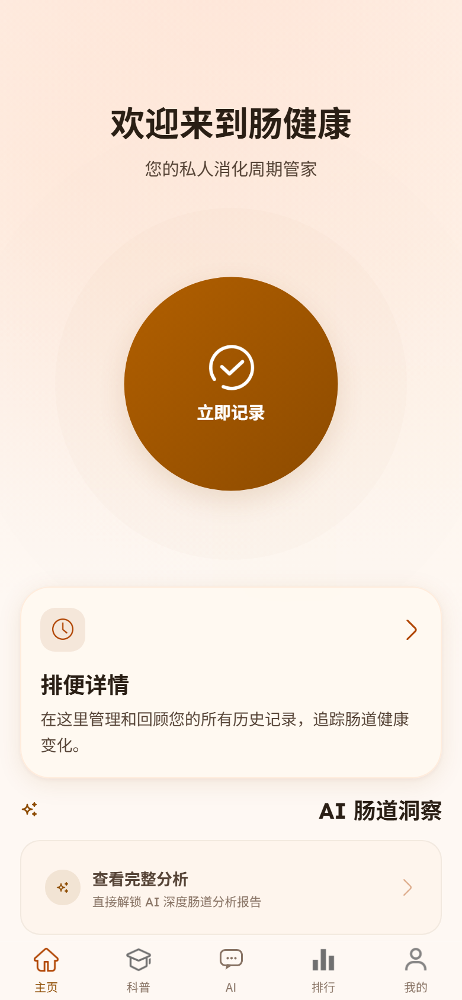</td>
    <td>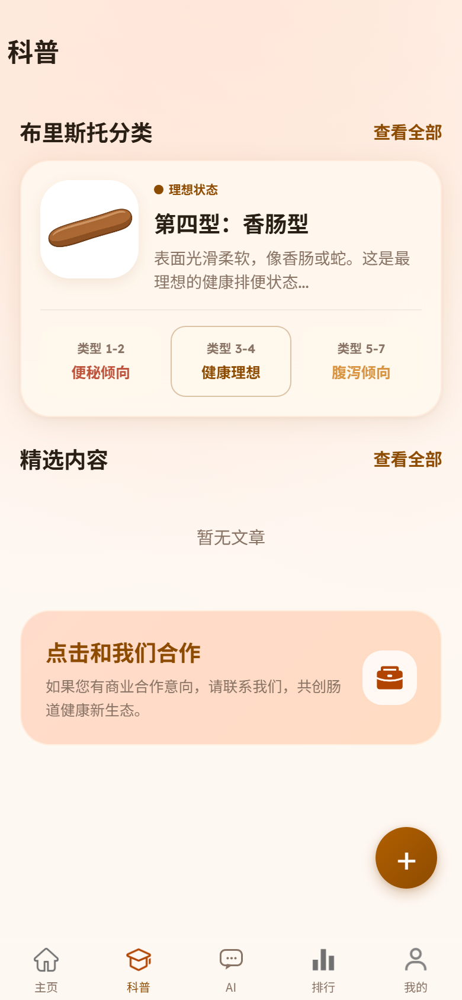</td>
    <td>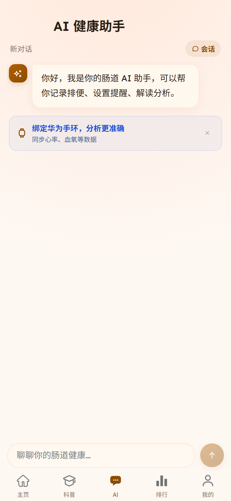</td>
  </tr>
  <tr>
    <td align="center">首页</td>
    <td align="center">科普</td>
    <td align="center">AI 健康助手</td>
  </tr>
  <tr>
    <td>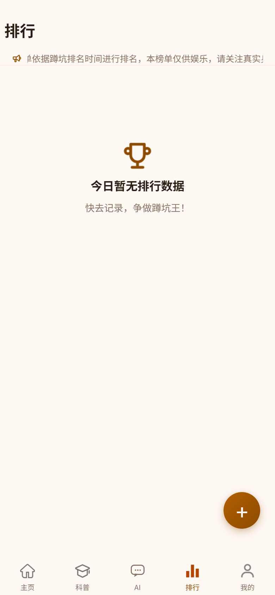</td>
    <td>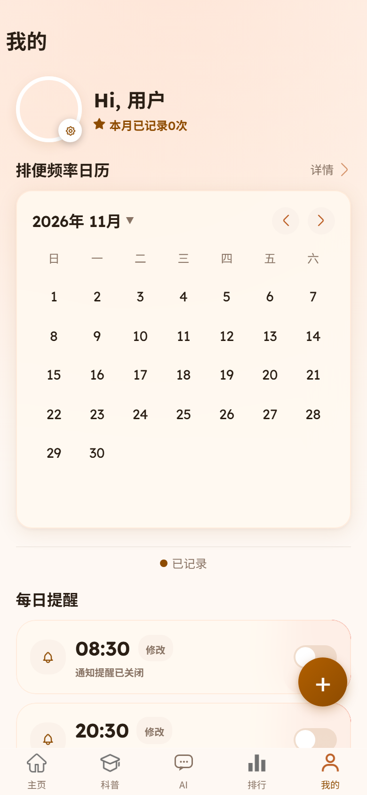</td>
    <td>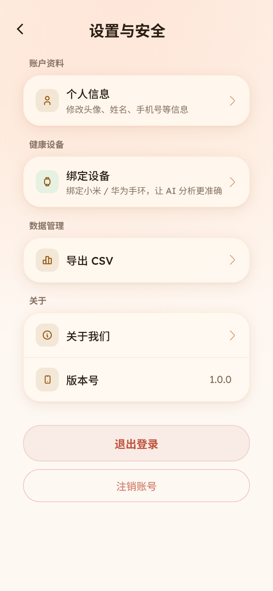</td>
  </tr>
  <tr>
    <td align="center">排行榜</td>
    <td align="center">我的</td>
    <td align="center">设置与安全</td>
  </tr>
</table>

### 主要功能

- 排便记录：布里斯托分类、排便时间、颜色、排便感受、饮水量、膳食纤维和备注，也支持计时记录
- 统计分析：按日、周、月查看排便频率、趋势和活跃时间段
- 科普内容：分类浏览文章，支持收藏和点赞
- 排行榜：按记录时长参与排行
- AI 健康助手：日常对话和肠道分析报告
- 提醒订阅：每日提醒推送，支持绑定华为手环同步健康数据
- 账户管理：资料编辑、设备绑定、CSV 导出和账号注销

### 目录结构

```
serenegut-C
├── pages
│   ├── index/index.vue                  首页
│   ├── education/education.vue          科普
│   ├── chat/chat.vue                    AI 健康助手
│   ├── ranking/ranking.vue              排行榜
│   ├── profile/profile.vue              我的
│   ├── health
│   │   ├── bristol/bristol.vue           布里斯托分类法
│   │   ├── record/record.vue             记录详情
│   │   ├── statistics/statistics.vue     统计分析
│   │   ├── timer/timer.vue               计时记录
│   │   └── type-select/type-select.vue   选择类型
│   ├── content
│   │   ├── article/article.vue           文章详情
│   │   ├── article-list/article-list.vue 科普列表
│   │   └── contact/contact.vue           商务合作
│   ├── user-settings
│   │   ├── settings/settings.vue         设置与安全
│   │   ├── edit-profile/edit-profile.vue 资料编辑
│   │   └── devices/devices.vue           设备绑定
│   ├── others
│   │   ├── ai-analysis/ai-analysis.vue   AI 分析报告
│   │   └── nav-demo/nav-demo.vue         导航栏演示
│   └── admin/sync-config/sync-config.vue 同步配置
├── components
│   ├── custom-nav/custom-nav.vue         自定义导航栏
│   ├── AppIcon/AppIcon.vue               图标组件
│   ├── FloatingRecordButton              悬浮记录按钮
│   ├── TimePicker/TimePicker.vue         时间选择
│   ├── DatePicker/DatePicker.vue         日期选择
│   ├── CustomCalendar.vue                日历
│   ├── ConfirmModal/ConfirmModal.vue     确认弹窗
│   ├── InputModal/InputModal.vue         输入弹窗
│   ├── AnnouncementModal                 公告弹窗
│   ├── CustomToast/CustomToast.vue       轻提示
│   ├── MenstruationModal                 经期弹窗
│   └── article-list/article-list.vue     文章卡片
├── js_sdk/sg-client/api.js              云函数调用封装
├── plugins/toast.js                     全局轻提示插件
├── utils/sync.js                        本地队列与批量同步
├── static
│   ├── images                           品牌图与底栏图标
│   └── icons                            功能图标
├── uniCloud-aliyun
│   ├── cloudfunctions
│   │   ├── client-api/index.js          小程序业务云函数
│   │   └── common/uni-config-center     公共配置模块
│   └── database                         数据库结构定义
├── App.vue                              应用生命周期
├── main.js                              应用入口
├── pages.json                           页面与底栏配置
├── manifest.json                        应用与小程序配置
├── uni.scss                             全局样式变量
├── index.html                           H5 模板
├── package.json                         依赖与编译脚本
├── vite.config.js                       Vite 配置
└── uni.promisify.adaptor.js             Promise 适配
```

### 部署步骤

1. 用 HBuilderX 导入 serenegut-C 目录。
2. 右键 uniCloud-aliyun，选择关联云服务空间。没有服务空间时先到 uniCloud 控制台创建。
3. 右键 cloudfunctions/common/uni-config-center，上传公共模块。
4. 右键 cloudfunctions/client-api，上传部署云函数。
5. 打开 database 目录，逐个右键 schema 文件上传数据库结构。需要的集合有 users、records、article、article_comment、announcements、app_config、ai_models、ai_reports、health_devices、health_metrics 和 reminder_subscriptions。
6. 打开 manifest.json，把微信小程序 AppID 换成自己的小程序。仓库中的 wxdb04f8f1e3fe00bb 是原开发用的 AppID。
7. 打开微信开发者工具，在设置的安全设置里开启服务端口。回到 HBuilderX，运行到小程序模拟器，选择微信开发者工具。
8. 检查 uni-id 配置。uni-config-center/uni-id/config.json 里的 passwordSecret 和 tokenSecret 改成随机字符串，微信登录的 appid 和 appsecret 填入自己的小程序信息。
9. 订阅消息模板 ID 在 client-api 顶部的 REMINDER_TEMPLATE_ID 中修改，替换成微信公众平台申请到的模板。
10. 发布时使用 HBuilderX 的发行菜单，发行到小程序，上传代码后在微信公众平台提交审核。

## 管理后台

### 界面预览

<table>
  <tr>
    <td>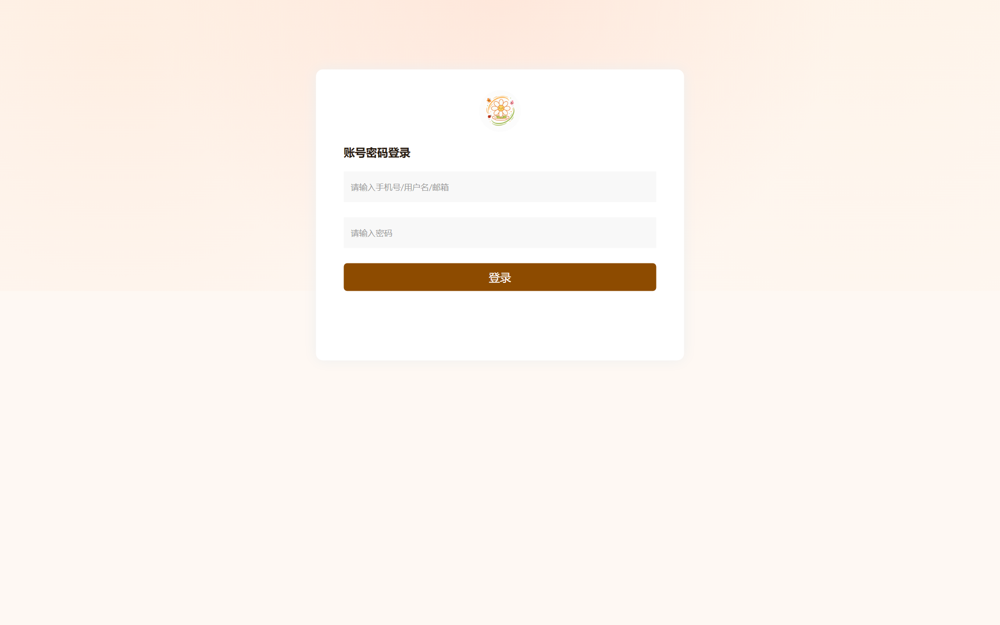</td>
    <td></td>
  </tr>
  <tr>
    <td align="center">登录</td>
    <td align="center">数据总览</td>
  </tr>
  <tr>
    <td>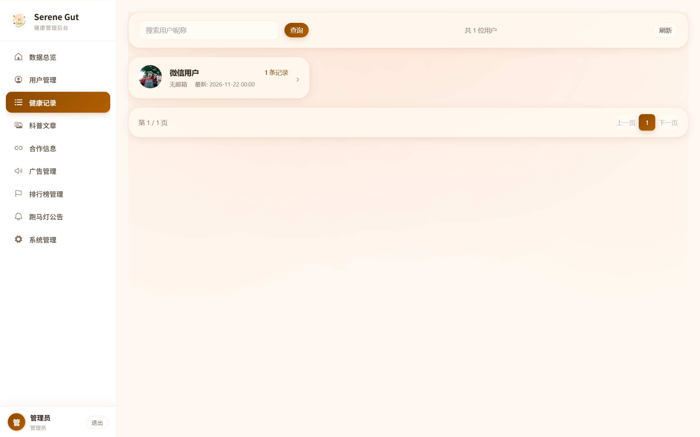</td>
    <td>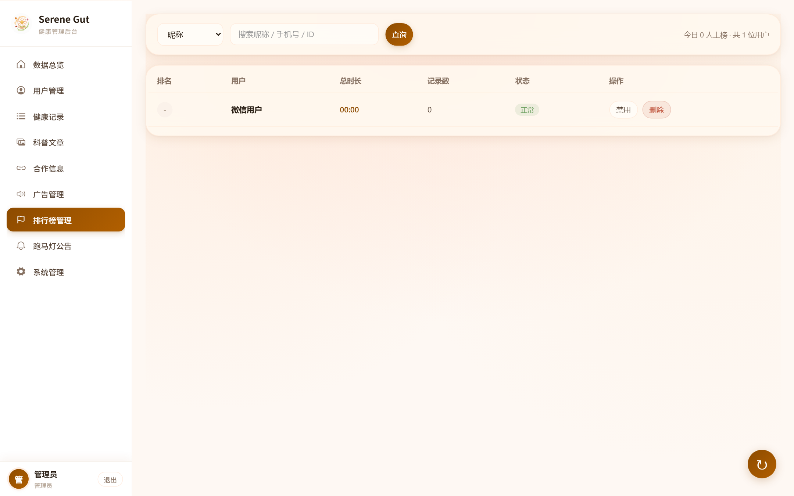</td>
  </tr>
  <tr>
    <td align="center">健康记录</td>
    <td align="center">排行榜管理</td>
  </tr>
  <tr>
    <td>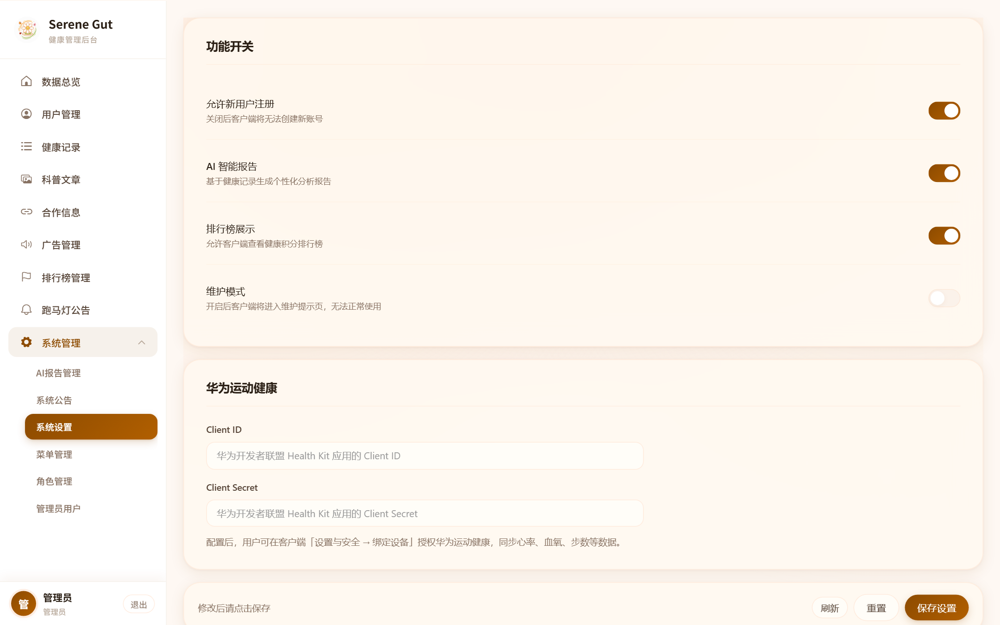</td>
    <td>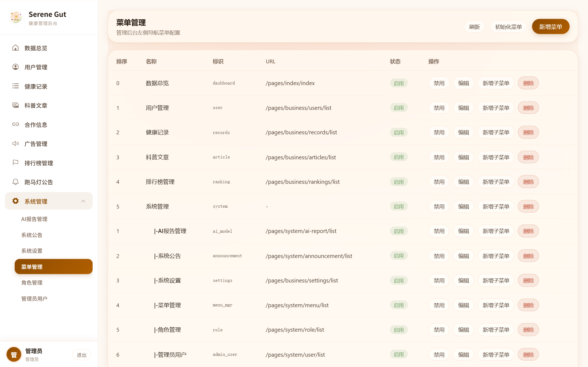</td>
  </tr>
  <tr>
    <td align="center">系统设置</td>
    <td align="center">菜单管理</td>
  </tr>
</table>

### 主要功能

- 数据总览：用户、记录和文章等核心指标与增长趋势
- 用户管理：查询用户，按指定时长封禁或解封
- 健康记录：查看用户提交的记录
- 科普文章：发布、编辑、上下架和分类管理
- 合作信息、广告管理和排行榜维护
- 公告管理：跑马灯公告和弹窗公告
- 系统管理：管理员、角色、权限、菜单、AI 报告和系统设置

### 目录结构

```
serenegut-admin
├── pages
│   ├── index/index.vue                  数据总览
│   ├── error/404.vue                    错误页
│   ├── business
│   │   ├── users/list.vue               用户管理
│   │   ├── records/list.vue             健康记录
│   │   ├── articles/list.vue            文章列表
│   │   ├── articles/edit.vue            文章编辑
│   │   ├── rankings/list.vue            排行榜管理
│   │   ├── cooperation/list.vue         合作信息
│   │   ├── ad/list.vue                  广告管理
│   │   ├── devices/list.vue             设备管理
│   │   ├── ranking-notice/list.vue      跑马灯公告
│   │   └── settings/list.vue            系统设置
│   └── system
│       ├── user/list.vue                管理员用户
│       ├── role/list.vue                角色管理
│       ├── permission/list.vue          权限管理
│       ├── menu/list.vue                菜单管理
│       ├── announcement/list.vue        系统公告
│       └── ai-report/list.vue           AI 报告管理
├── windows
│   ├── leftWindow.vue                   左侧菜单容器
│   └── topWindow.vue                    顶部容器
├── components                           后台通用组件
├── common                               主题变量与公共样式
├── store                                状态管理
├── i18n                                 多语言文案
├── js_sdk/uni-admin                     后台插件
├── uni_modules                          uni-admin 组件与云函数
├── uniCloud-aliyun
│   ├── cloudfunctions/admin-api         后台业务云函数
│   └── database                         菜单、公告与 uni-id 结构
├── admin.config.js                      登录页与导航配置
├── App.vue                              应用生命周期
├── main.js                              应用入口
├── pages.json                           页面配置
├── manifest.json                        应用与 H5 配置
├── uni.scss                             全局样式变量
├── index.html                           H5 模板
├── template.h5.html                     H5 页面模板
├── package.json                         项目信息
├── vue.config.js                        打包配置
├── postcss.config.js                    PostCSS 配置
└── prettier.config.js                   代码格式配置
```

### 部署步骤

1. 用 HBuilderX 导入 serenegut-admin 目录。
2. 关联与小程序端相同的云服务空间。两端必须使用同一个空间，否则读写的是不同的数据库。
3. 上传 uni_modules 下的公共模块和云函数，包括 uni-config-center、uni-id-co、uni-captcha-co、uni-clientDB-actions 和 rewarded-video-ad-notify-url。
4. 右键 cloudfunctions/admin-api，上传部署云函数。
5. 打开 database 目录，上传 announcements、opendb-admin-menus、uni-id-users、uni-id-roles、uni-id-permissions、uni-id-log 和 opendb-verify-codes 的结构。
6. 运行到浏览器。首次进入会引导创建超级管理员，按页面提示填写账号和密码。
7. 登录后进入系统管理里的菜单管理，点击初始化菜单并导入 opendb-admin-menus.init_data.json，刷新页面后左侧菜单才会完整显示。
8. 在系统管理里的系统设置中配置 AI 模型、功能开关和华为运动健康参数。保存之后小程序端的 AI 对话和分析报告才能正常工作。
9. 发布时使用 HBuilderX 的发行菜单，发行到网站。产物在 unpackage/dist/build/web，可以部署到 uniCloud 前端网页托管，也可以放到自己的服务器。
10. 后台部署到自有域名后，需要到 uniCloud 控制台的跨域配置里加入该域名，否则浏览器会拦截云函数请求。

## 数据结构与接口

- client-api 按 module 分发小程序请求，模块包括 user、records、article、ranking、config、auth、sync、ai、announcement、bristol、reminder 和 device。
- admin-api 提供管理后台接口，模块包括 dashboard、user、records、article、ranking、config、ai_model、announcement、device 和 menu。
- 小程序端数据库包含 users、records、article、article_comment、announcements、app_config、ai_models、ai_reports、health_devices、health_metrics 和 reminder_subscriptions。
- 管理后台数据库包含 announcements、opendb-admin-menus、uni-id-users、uni-id-roles、uni-id-permissions、uni-id-log 和 opendb-verify-codes。
- 数据库结构放在两端的 uniCloud-aliyun/database 目录，修改 schema 后需要重新上传。

## 注意事项

- 仓库只保留两端源码，不包含 node_modules、unpackage、dist 和 HBuilderX 的本地配置。
- 云函数里的密码与密钥请自行生成，不要沿用示例值。
- AI 对话使用 OpenAI 兼容接口，当前默认接入 DeepSeek，可以在后台切换服务商。
- 小程序发布前需要在微信公众平台配置服务器域名和订阅消息模板。

## 开发信息

- 开发时间：2026 年 6 月至 2026 年 8 月
- 联系邮箱：rjxiaofj@gmail.com