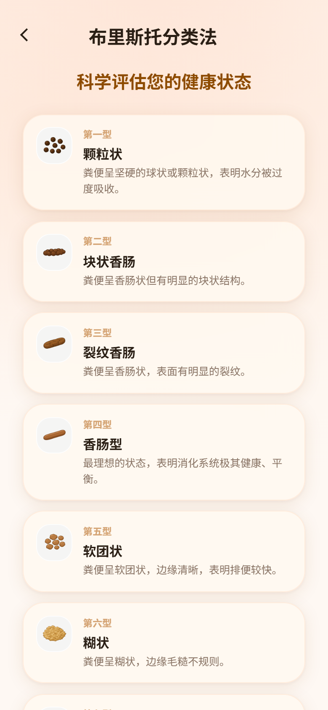
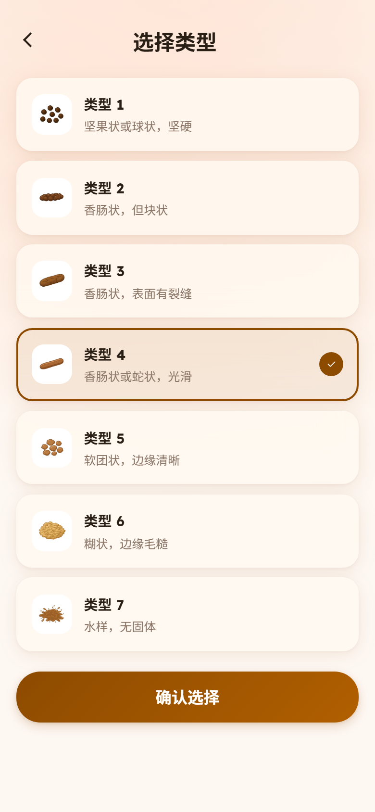
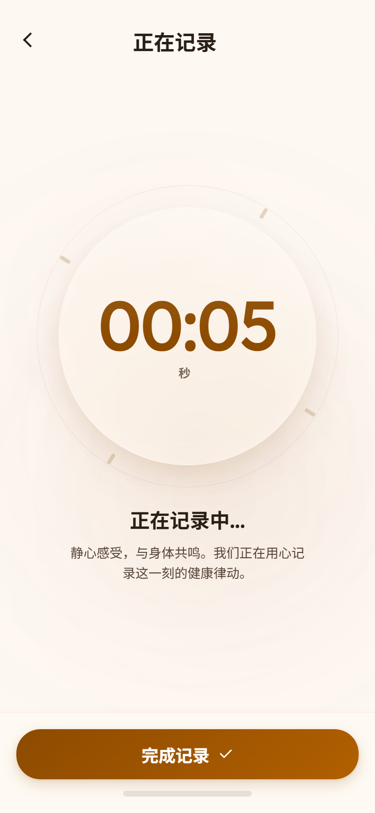
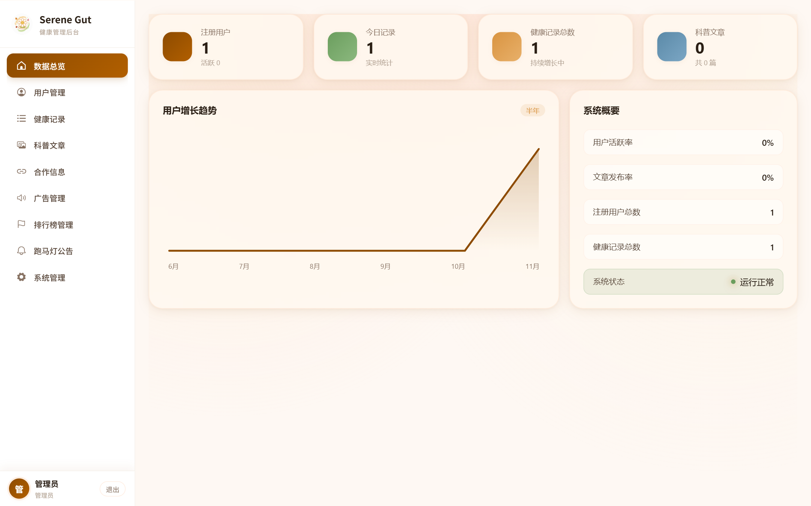

# Serene Gut 肠道健康管理应用

Serene Gut 是一套面向肠道健康管理的应用，由微信小程序端和 Web 管理后台组成。用户在小程序里记录排便情况，包括布里斯托分类、排便时间、颜色、饮水量和膳食纤维，系统把这些记录整理成日、周、月统计与趋势。运营人员在管理后台维护文章、用户、记录和系统配置。

两端都使用 uni-app 的 Vue 3 语法开发，后端基于 uniCloud 阿里云服务空间，数据存放在云数据库，业务逻辑集中在 client-api 和 admin-api 两个云函数里。

## 界面预览

<table>
  <tr>
    <td></td>
    <td></td>
    <td></td>
    <td></td>
  </tr>
  <tr>
    <td align="center">首页</td>
    <td align="center">布里斯托分类法</td>
    <td align="center">选择类型</td>
    <td align="center">记录计时</td>
  </tr>
</table>

<table>
  <tr>
    <td></td>
    <td></td>
    <td></td>
  </tr>
  <tr>
    <td align="center">设置与安全</td>
    <td align="center">后台登录</td>
    <td align="center">数据总览</td>
  </tr>
</table>

## 功能

### 小程序端

- 排便记录：布里斯托分类、排便时间、颜色、排便感受、饮水量、膳食纤维和备注，也支持计时记录
- 统计分析：按日、周、月查看排便频率、趋势和活跃时间段
- 科普内容：分类浏览文章，支持收藏和点赞
- 排行榜：按记录时长参与排行
- AI 健康助手：日常对话和肠道分析报告
- 提醒订阅：每日提醒推送，支持绑定华为手环同步健康数据
- 账户管理：资料编辑、设备绑定、CSV 导出和账号注销

### 管理后台

- 数据总览：用户、记录和文章等核心指标与增长趋势
- 用户管理：查询用户，按指定时长封禁或解封
- 健康记录：查看用户提交的记录
- 科普文章：发布、编辑、上下架和分类管理
- 合作信息、广告管理和排行榜维护
- 公告管理：跑马灯公告和弹窗公告
- 系统管理：管理员、角色、权限、菜单、AI 模型和同步配置

## 目录结构

```
.
├── serenegut-C/              小程序端
│   ├── pages/                页面
│   ├── components/           通用组件
│   ├── js_sdk/sg-client/     接口封装
│   ├── uniCloud-aliyun/      云函数与数据库结构
│   └── static/               图片与图标
├── serenegut-admin/          管理后台
│   ├── pages/                页面
│   ├── uni_modules/          uni-admin 组件与云函数
│   ├── uniCloud-aliyun/      云函数与数据库结构
│   └── store/                状态管理
└── docs/screenshots/         界面截图
```

## 环境准备

- HBuilderX 4.24 或更高版本
- 微信开发者工具
- uniCloud 阿里云服务空间
- Node.js 18 以上，仅在使用命令行编译时需要

## 小程序端部署

1. 用 HBuilderX 导入 serenegut-C 目录。
2. 右键 uniCloud-aliyun，选择关联云服务空间。没有服务空间时先到 uniCloud 控制台创建。
3. 右键 cloudfunctions/common/uni-config-center，上传公共模块。
4. 右键 cloudfunctions/client-api，上传部署云函数。
5. 打开 database 目录，逐个右键 schema 文件上传数据库结构。需要的集合有 users、records、article、article_comment、announcements、app_config、ai_models、ai_reports、health_devices、health_metrics 和 reminder_subscriptions。
6. 打开 manifest.json，把微信小程序 AppID 换成自己的小程序。仓库中的 wxdb04f8f1e3fe00bb 是原开发用的 AppID。
7. 打开微信开发者工具，在设置的安全设置里开启服务端口。回到 HBuilderX，运行到小程序模拟器，选择微信开发者工具。
8. 检查 uni-id 配置。uni-config-center/uni-id/config.json 里的 passwordSecret 和 tokenSecret 改成随机字符串，微信登录的 appid 和 appsecret 填入自己的小程序信息。
9. 订阅消息模板 ID 在 client-api 顶部的 REMINDER_TEMPLATE_ID 中修改，替换成微信公众平台申请到的模板。
10. 发布时使用 HBuilderX 的发行菜单，发行到小程序，上传代码后在微信公众平台提交审核。

## 管理后台部署

1. 用 HBuilderX 导入 serenegut-admin 目录。
2. 关联与小程序端相同的云服务空间。两端必须使用同一个空间，否则读写的是不同的数据库。
3. 上传 uni_modules 下的公共模块和云函数，包括 uni-config-center、uni-id-co、uni-captcha-co、uni-clientDB-actions 和 rewarded-video-ad-notify-url。
4. 右键 cloudfunctions/admin-api，上传部署云函数。
5. 打开 database 目录，上传 announcements、opendb-admin-menus、uni-id-users、uni-id-roles、uni-id-permissions、uni-id-log 和 opendb-verify-codes 的结构。
6. 运行到浏览器。首次进入会引导创建超级管理员，按页面提示填写账号和密码。
7. 登录后进入系统管理里的菜单管理，点击初始化菜单并导入 opendb-admin-menus.init_data.json，刷新页面后左侧菜单才会完整显示。
8. 在系统管理的系统设置里填写 AI 模型的 api_url、api_key 和 model。保存之后小程序端的 AI 对话和分析报告才能正常工作。
9. 发布时使用 HBuilderX 的发行菜单，发行到网站。产物在 unpackage/dist/build/web，可以部署到 uniCloud 前端网页托管，也可以放到自己的服务器。
10. 后台部署到自有域名后，需要到 uniCloud 控制台的跨域配置里加入该域名，否则浏览器会拦截云函数请求。

## 接口与数据

- client-api 按 module 分发小程序请求，模块包括 user、records、article、ranking、config、auth、sync、ai、announcement、bristol、reminder 和 device。
- admin-api 提供管理后台接口，模块包括 dashboard、user、records、article、ranking、config、ai_model、announcement、device 和 menu。
- 数据库结构放在两端的 uniCloud-aliyun/database 目录，修改 schema 后需要重新上传。

## 注意事项

- 仓库只保留两端源码，不包含 node_modules、unpackage、dist 和 HBuilderX 的本地配置。
- 云函数里的密码与密钥请自行生成，不要沿用示例值。
- AI 对话使用 OpenAI 兼容接口，当前默认接入 DeepSeek，可以在后台切换服务商。
- 小程序发布前需要在微信公众平台配置服务器域名和订阅消息模板。

## 开发时间

2026 年 6 月至 2026 年 8 月。

## 联系方式

邮箱：rjxiaofj@gmail.com